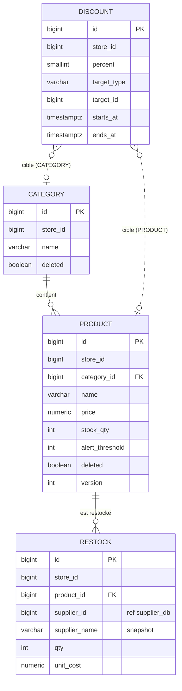
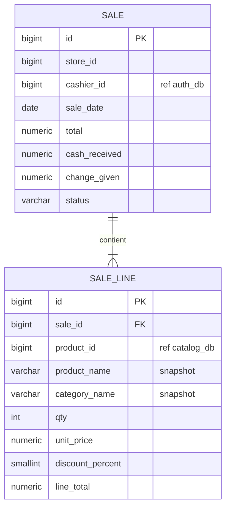

# DATABASE SCHEMA — Store Management

Voir aussi : [PRD.md](PRD.md) · [IMPLEMENTATION.md](IMPLEMENTATION.md)

## 0. Principes
- **Une base par service** (PostgreSQL 16) : `auth_db`, `catalog_db`, `supplier_db`, `sales_db`, `reporting_db`.
- **Aucune clé étrangère entre bases.** Une référence vers un autre service est un simple `BIGINT` (ex. `supplier_id`), accompagné d'une copie (snapshot) des champs affichés (ex. `supplier_name`). L'historique reste donc lisible même si l'objet source est modifié ou supprimé.
- **Multi-tenant** : toute table métier porte `store_id`, et toute requête filtre dessus. `store_id` vient du JWT.
- Identifiants : `BIGINT GENERATED ALWAYS AS IDENTITY`. Événements Kafka : `UUID`.
- Montants : `NUMERIC(12,2)`. Dates : `TIMESTAMPTZ` (UTC). « Jour de vente » : `DATE` calculée dans le fuseau du store.
- Suppression logique : `deleted BOOLEAN NOT NULL DEFAULT false` sur les tables référencées par un historique.
- Les scripts ci-dessous sont les migrations Flyway `V1__init.sql` de chaque service (Hibernate en `ddl-auto=validate`).

### 0.1 Table `outbox_event` (catalog_db et sales_db)
Les services qui produisent des événements Kafka (catalog, sales) ajoutent cette table à leur `V1__init.sql`. Elle est lue par `OutboxRelay` (module `common`).
```sql
CREATE TABLE outbox_event (
    id          UUID         PRIMARY KEY,         -- envoyé en header Kafka "eventId"
    topic       VARCHAR(100) NOT NULL,
    msg_key     VARCHAR(100) NOT NULL,            -- store_id : ordre garanti par store
    payload     TEXT         NOT NULL,            -- JSON de l'événement
    created_at  TIMESTAMPTZ  NOT NULL DEFAULT now(),
    sent_at     TIMESTAMPTZ
);
CREATE INDEX ix_outbox_unsent ON outbox_event(created_at) WHERE sent_at IS NULL;
```

## 1. auth_db (auth-service)

```mermaid
erDiagram
    STORE ||--o{ APP_USER : emploie
    APP_USER ||--o{ USER_PERMISSION : possede
    STORE {
        bigint id PK
        varchar name
        varchar timezone
        varchar currency
    }
    APP_USER {
        bigint id PK
        bigint store_id FK
        varchar email
        varchar password_hash
        varchar role
        boolean active
    }
    USER_PERMISSION {
        bigint user_id PK
        varchar permission PK
    }
```



```sql
CREATE TABLE store (
    id          BIGINT GENERATED ALWAYS AS IDENTITY PRIMARY KEY,
    name        VARCHAR(120) NOT NULL,
    timezone    VARCHAR(64)  NOT NULL DEFAULT 'Africa/Algiers',
    currency    VARCHAR(3)   NOT NULL DEFAULT 'DZD',   -- VARCHAR (pas CHAR) : compatible ddl-auto=validate
    created_at  TIMESTAMPTZ  NOT NULL DEFAULT now()
);

CREATE TABLE app_user (
    id             BIGINT GENERATED ALWAYS AS IDENTITY PRIMARY KEY,
    store_id       BIGINT       NOT NULL REFERENCES store(id),
    name           VARCHAR(120) NOT NULL,
    email          VARCHAR(180) NOT NULL,
    password_hash  VARCHAR(100) NOT NULL,              -- BCrypt
    role           VARCHAR(10)  NOT NULL CHECK (role IN ('ADMIN','MANAGER','GUEST')),
    active         BOOLEAN      NOT NULL DEFAULT true,
    created_at     TIMESTAMPTZ  NOT NULL DEFAULT now(),
    UNIQUE (store_id, email)
);
-- un seul ADMIN par store (v1)
CREATE UNIQUE INDEX ux_one_admin_per_store ON app_user(store_id) WHERE role = 'ADMIN';
-- login : l'email est globalement unique pour identifier le store à la connexion
CREATE UNIQUE INDEX ux_user_email ON app_user(lower(email));

CREATE TABLE user_permission (
    user_id     BIGINT      NOT NULL REFERENCES app_user(id) ON DELETE CASCADE,
    permission  VARCHAR(40) NOT NULL,
    PRIMARY KEY (user_id, permission)
);
```

**Notes**
- Le catalogue des permissions est un `enum Permission` Java (et non une table) : ajouter une fonctionnalité = ajouter une valeur à l'enum.
- ADMIN : aucune ligne dans `user_permission`, il reçoit toutes les permissions à l'émission du JWT.
- Création d'un GUEST : insertion automatique de `SALE_CREATE`.
- L'email est unique **globalement**, car le login se fait sans choisir de store. `UNIQUE(store_id, email)` est donc redondant mais documente l'intention.

## 2. catalog_db (catalog-service)



```sql
CREATE TABLE category (
    id          BIGINT GENERATED ALWAYS AS IDENTITY PRIMARY KEY,
    store_id    BIGINT       NOT NULL,
    name        VARCHAR(80)  NOT NULL,
    deleted     BOOLEAN      NOT NULL DEFAULT false,
    created_at  TIMESTAMPTZ  NOT NULL DEFAULT now()
);
CREATE UNIQUE INDEX ux_category_name ON category(store_id, lower(name)) WHERE NOT deleted;

CREATE TABLE product (
    id               BIGINT GENERATED ALWAYS AS IDENTITY PRIMARY KEY,
    store_id         BIGINT        NOT NULL,
    category_id      BIGINT        NOT NULL REFERENCES category(id),
    name             VARCHAR(120)  NOT NULL,
    code             VARCHAR(50),                                 -- code-barres / référence, optionnel
    price            NUMERIC(12,2) NOT NULL CHECK (price > 0),
    stock_qty        INTEGER       NOT NULL DEFAULT 0 CHECK (stock_qty >= 0),
    alert_threshold  INTEGER       NOT NULL DEFAULT 5 CHECK (alert_threshold >= 0),
    deleted          BOOLEAN       NOT NULL DEFAULT false,
    version          INTEGER       NOT NULL DEFAULT 0,             -- @Version (verrou optimiste)
    created_at       TIMESTAMPTZ   NOT NULL DEFAULT now(),
    updated_at       TIMESTAMPTZ   NOT NULL DEFAULT now()
);
CREATE INDEX ix_product_store_category ON product(store_id, category_id) WHERE NOT deleted;
CREATE UNIQUE INDEX ux_product_code ON product(store_id, code) WHERE code IS NOT NULL AND NOT deleted;
-- produits en stock bas / rupture
CREATE INDEX ix_product_low_stock ON product(store_id) WHERE NOT deleted AND stock_qty <= alert_threshold;

CREATE TABLE discount (
    id           BIGINT GENERATED ALWAYS AS IDENTITY PRIMARY KEY,
    store_id     BIGINT       NOT NULL,
    label        VARCHAR(120) NOT NULL,
    percent      SMALLINT     NOT NULL CHECK (percent BETWEEN 1 AND 100),
    target_type  VARCHAR(10)  NOT NULL CHECK (target_type IN ('PRODUCT','CATEGORY')),
    target_id    BIGINT       NOT NULL,          -- product.id ou category.id selon target_type
    starts_at    TIMESTAMPTZ  NOT NULL,
    ends_at      TIMESTAMPTZ  NOT NULL,
    created_by   BIGINT       NOT NULL,          -- ref auth_db.app_user
    created_at   TIMESTAMPTZ  NOT NULL DEFAULT now(),
    CHECK (ends_at > starts_at)
);
CREATE INDEX ix_discount_lookup ON discount(store_id, target_type, target_id, starts_at, ends_at);

CREATE TABLE restock (
    id             BIGINT GENERATED ALWAYS AS IDENTITY PRIMARY KEY,
    store_id       BIGINT        NOT NULL,
    product_id     BIGINT        NOT NULL REFERENCES product(id),
    supplier_id    BIGINT        NOT NULL,       -- ref supplier_db.supplier
    supplier_name  VARCHAR(120)  NOT NULL,       -- snapshot
    qty            INTEGER       NOT NULL CHECK (qty > 0),
    unit_cost      NUMERIC(12,2) CHECK (unit_cost >= 0),   -- prix d'achat, optionnel
    user_id        BIGINT        NOT NULL,
    user_name      VARCHAR(120)  NOT NULL,       -- snapshot
    created_at     TIMESTAMPTZ   NOT NULL DEFAULT now()
);
CREATE INDEX ix_restock_product  ON restock(store_id, product_id, created_at DESC);
CREATE INDEX ix_restock_supplier ON restock(store_id, supplier_id, created_at DESC);
```

**Remise effective d'un produit** (utilisée par la caisse et l'affichage) :
```sql
SELECT COALESCE(MAX(d.percent), 0)
FROM discount d
WHERE d.store_id = :storeId
  AND now() >= d.starts_at AND now() < d.ends_at
  AND ( (d.target_type = 'PRODUCT'  AND d.target_id = :productId)
     OR (d.target_type = 'CATEGORY' AND d.target_id = :categoryId) );
```

**Décrément atomique** (garantit l'absence de survente) :
```sql
UPDATE product SET stock_qty = stock_qty - :qty, updated_at = now()
WHERE id = :id AND store_id = :storeId AND NOT deleted AND stock_qty >= :qty;
-- 0 ligne modifiée => INSUFFICIENT_STOCK
```

## 3. supplier_db (supplier-service)

```sql
CREATE TABLE supplier (
    id          BIGINT GENERATED ALWAYS AS IDENTITY PRIMARY KEY,
    store_id    BIGINT        NOT NULL,
    name        VARCHAR(120)  NOT NULL,
    phone       VARCHAR(30),
    email       VARCHAR(180),
    address     VARCHAR(255),
    deleted     BOOLEAN       NOT NULL DEFAULT false,
    created_at  TIMESTAMPTZ   NOT NULL DEFAULT now()
);
CREATE UNIQUE INDEX ux_supplier_name ON supplier(store_id, lower(name)) WHERE NOT deleted;
```

L'historique des restockages d'un fournisseur (US-4.3) est servi par catalog-service (`GET /api/catalog/restocks?supplierId=`).

## 4. sales_db (sales-service)



```sql
CREATE TABLE sale (
    id             BIGINT GENERATED ALWAYS AS IDENTITY PRIMARY KEY,   -- = n° de ticket
    store_id       BIGINT        NOT NULL,
    cashier_id     BIGINT        NOT NULL,
    cashier_name   VARCHAR(120)  NOT NULL,       -- snapshot
    sale_date      DATE          NOT NULL,       -- jour local du store
    total          NUMERIC(12,2) NOT NULL CHECK (total >= 0),
    cash_received  NUMERIC(12,2) NOT NULL,
    change_given   NUMERIC(12,2) NOT NULL CHECK (change_given >= 0),
    status         VARCHAR(10)   NOT NULL DEFAULT 'COMPLETED' CHECK (status IN ('COMPLETED','CANCELLED')),
    cancelled_by   BIGINT,
    cancelled_at   TIMESTAMPTZ,
    created_at     TIMESTAMPTZ   NOT NULL DEFAULT now(),
    CHECK (cash_received >= total),
    CHECK ((status = 'CANCELLED') = (cancelled_at IS NOT NULL))
);
CREATE INDEX ix_sale_store_day         ON sale(store_id, sale_date);
CREATE INDEX ix_sale_store_cashier_day ON sale(store_id, cashier_id, sale_date);

CREATE TABLE sale_line (
    id                BIGINT GENERATED ALWAYS AS IDENTITY PRIMARY KEY,
    sale_id           BIGINT        NOT NULL REFERENCES sale(id) ON DELETE CASCADE,
    product_id        BIGINT        NOT NULL,
    product_name      VARCHAR(120)  NOT NULL,
    category_id       BIGINT        NOT NULL,
    category_name     VARCHAR(80)   NOT NULL,
    qty               INTEGER       NOT NULL CHECK (qty > 0),
    unit_price        NUMERIC(12,2) NOT NULL,     -- prix catalogue au moment de la vente
    discount_percent  SMALLINT      NOT NULL DEFAULT 0 CHECK (discount_percent BETWEEN 0 AND 100),
    line_total        NUMERIC(12,2) NOT NULL      -- qty * unit_price * (1 - discount/100), arrondi HALF_UP
);
CREATE INDEX ix_sale_line_sale ON sale_line(sale_id);
```

## 5. reporting_db (reporting-service)

Ce sont des tables de lecture (read model) alimentées uniquement par Kafka. Elles sont reconstructibles et ne servent jamais de source de vérité.

```sql
-- graphes produits / catégories, produits vendus du jour, CA par période
CREATE TABLE daily_product_sales (
    store_id       BIGINT        NOT NULL,
    sale_date      DATE          NOT NULL,
    product_id     BIGINT        NOT NULL,
    product_name   VARCHAR(120)  NOT NULL,       -- dernier nom connu
    category_id    BIGINT        NOT NULL,
    category_name  VARCHAR(80)   NOT NULL,
    qty            INTEGER       NOT NULL DEFAULT 0,
    revenue        NUMERIC(14,2) NOT NULL DEFAULT 0,
    PRIMARY KEY (store_id, sale_date, product_id)
);
CREATE INDEX ix_dps_category ON daily_product_sales(store_id, category_id, sale_date);

-- encaissé du jour par caissier (guest + admin)
CREATE TABLE daily_cashier_sales (
    store_id      BIGINT        NOT NULL,
    sale_date     DATE          NOT NULL,
    cashier_id    BIGINT        NOT NULL,
    cashier_name  VARCHAR(120)  NOT NULL,
    ticket_count  INTEGER       NOT NULL DEFAULT 0,
    total         NUMERIC(14,2) NOT NULL DEFAULT 0,
    PRIMARY KEY (store_id, sale_date, cashier_id)
);

CREATE TABLE notification (
    id            BIGINT GENERATED ALWAYS AS IDENTITY PRIMARY KEY,
    store_id      BIGINT        NOT NULL,
    product_id    BIGINT        NOT NULL,
    product_name  VARCHAR(120)  NOT NULL,
    type          VARCHAR(5)    NOT NULL CHECK (type IN ('LOW','OUT')),
    stock_qty     INTEGER       NOT NULL,
    resolved_at   TIMESTAMPTZ,                    -- posé lors d'un stock.restocked
    created_at    TIMESTAMPTZ   NOT NULL DEFAULT now()
);
-- une seule notification ouverte par produit et par type
CREATE UNIQUE INDEX ux_notification_open ON notification(store_id, product_id, type) WHERE resolved_at IS NULL;
CREATE INDEX ix_notification_store ON notification(store_id, created_at DESC);

-- statut lu propre à chaque utilisateur (ligne présente = lu)
CREATE TABLE notification_read (
    notification_id  BIGINT      NOT NULL REFERENCES notification(id) ON DELETE CASCADE,
    user_id          BIGINT      NOT NULL,        -- ref auth_db.app_user
    read_at          TIMESTAMPTZ NOT NULL DEFAULT now(),
    PRIMARY KEY (notification_id, user_id)
);

-- idempotence des consommateurs Kafka
CREATE TABLE processed_event (
    event_id      UUID        PRIMARY KEY,
    processed_at  TIMESTAMPTZ NOT NULL DEFAULT now()
);
```

**Mise à jour sur `sale.completed`** (même transaction que l'insertion dans `processed_event`), pour chaque ligne :
```sql
INSERT INTO daily_product_sales AS d (store_id, sale_date, product_id, product_name, category_id, category_name, qty, revenue)
VALUES (:s, :day, :p, :pname, :c, :cname, :qty, :lineTotal)
ON CONFLICT (store_id, sale_date, product_id)
DO UPDATE SET qty = d.qty + EXCLUDED.qty, revenue = d.revenue + EXCLUDED.revenue,
              product_name = EXCLUDED.product_name, category_name = EXCLUDED.category_name;
```
`sale.cancelled` applique la même requête avec `-qty` / `-lineTotal` (et `ticket_count - 1` côté caissier).

**Requêtes du dashboard**
| Besoin | Requête |
|---|---|
| Encaissé du jour d'un guest | `daily_cashier_sales WHERE store_id=? AND sale_date=today AND cashier_id=?` |
| CA sur une période | `SUM(total) FROM daily_cashier_sales WHERE store_id=? AND sale_date BETWEEN ? AND ?` |
| Série CA jour par jour | même requête, `GROUP BY sale_date` |
| Top produits | `SUM(qty \| revenue) FROM daily_product_sales WHERE … [AND category_id=?] GROUP BY product_id ORDER BY 2 DESC LIMIT :n` |
| Top catégories | `… GROUP BY category_id ORDER BY 2 DESC LIMIT :n` |
| Produits vendus du jour | `daily_product_sales WHERE store_id=? AND sale_date=today` |
| Notifications non lues de l'utilisateur | `notification n WHERE n.store_id=? AND NOT EXISTS (SELECT 1 FROM notification_read r WHERE r.notification_id=n.id AND r.user_id=?)` |
| Marquer comme lue | `INSERT INTO notification_read(notification_id, user_id) VALUES (?, ?) ON CONFLICT DO NOTHING` |

## 6. Correspondance entités ↔ services

| Entité | Propriétaire | Référencée ailleurs par (snapshot) |
|---|---|---|
| Store, User, Permission | auth | `store_id` partout ; `cashier_id/name`, `user_id/name`, `created_by` |
| Category, Product, Discount, Restock | catalog | `product_id/name`, `category_id/name` dans sales et reporting |
| Supplier | supplier | `supplier_id/name` dans `restock` |
| Sale, SaleLine | sales | agrégés dans reporting |
| Notification, NotificationRead, agrégats | reporting | — |
| OutboxEvent | catalog, sales (chacun la sienne) | — |
