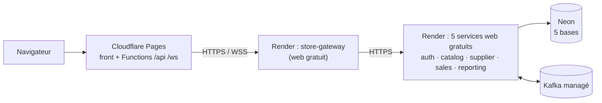

# Déploiement : Neon + Render + Cloudflare Pages

Ce guide met Store Manager en ligne :

| Brique | Hébergeur | Fichier du dépôt |
|---|---|---|
| Front Angular + relais `/api` et `/ws` | **Cloudflare Pages** (+ Pages Functions) | `frontend/functions/` |
| Gateway + 5 services | **Render**, offre gratuite (Blueprint) | `render.yaml` |
| 5 bases PostgreSQL | **Neon** | `infra/neon/setup.sql` |
| Kafka | Fournisseur managé (Confluent Cloud, Redpanda Serverless, Aiven…) | variables d'environnement |



**Ce qui change par rapport à Docker Compose, sans toucher au code métier :**

- **Pas d'Eureka.** Le profil Spring `render` donne aux services des adresses fixes (`application-render.yml`). Les services gratuits de Render ne reçoivent pas le trafic du réseau privé : ils s'appellent donc par leur **URL publique** (groupe de variables `store-urls`). Leurs routes restent protégées : JWT partout, et secret de service en plus sur `/internal/**`.
- **Pas de nginx.** Deux Pages Functions relaient `/api` et `/ws` vers la gateway. Le front reste sur une seule origine : pas de CORS, pas d'URL d'API dans le code Angular.
- **Port imposé par Render** via `PORT`. Pools de connexions réduits (3 par service).
- **Topics Kafka créés au démarrage** par les services, puisque la création automatique est souvent désactivée chez les fournisseurs managés.

Docker Compose fonctionne toujours exactement comme avant.

> **Tout est gratuit, sans carte bancaire**, avec les limites suivantes (à vérifier sur les grilles tarifaires) :
> - **Render, offre gratuite :**
>   - un service sans trafic s'endort après 15 min et met 1 à 3 min à se réveiller ;
>   - 750 h d'instance par mois, partagées par les 6 services, soit environ **125 h d'utilisation réelle de l'application par mois** ;
>   - minutes de build limitées : chaque déploiement reconstruit les 6 images.
> - **Ce que le code fait pour ces limites (profil `render`) :**
>   - la gateway réveille tous les services en même temps, et les garde éveillés tant que quelqu'un utilise l'application (`WakeUpPinger`) ;
>   - les délais d'attente montent à 3 min pour patienter pendant un réveil ;
>   - la JVM est réglée pour démarrer vite : mesuré en local avec une limite de 512 Mo, chaque service reste sous 300 Mo.
> - **Neon, offre gratuite :** la base s'endort quand les services dorment, ce qui ménage les heures de calcul.
> - **Kafka :** prendre une offre gratuite sans carte (voir §2).
> - **Cloudflare Pages :** gratuit.
>
> **À la première visite d'une session, comptez 2 à 4 minutes** que tout se réveille. Pour une démo c'est acceptable ; pour un vrai magasin, passez sur des plans payants (types `pserv` et `plan: starter` dans `render.yaml`).

---

## 1. Neon : les 5 bases

1. Créez un projet Neon dans la région **AWS Europe Central 1 (Frankfurt)**, la même que les services Render.
2. Dans *Connection details*, copiez la chaîne de connexion du rôle propriétaire. Prenez l'**hôte direct**, c'est-à-dire **sans** `-pooler` : Flyway pose un verrou de session pendant les migrations, que le pooler en mode transaction ne permet pas.
3. Choisissez **5 mots de passe longs et aléatoires**, un par service. Neon refuse les mots de passe faibles.
4. Exécutez le script, avec `psql` installé ou via Docker :

```bash
docker run --rm -i postgres:16 psql "postgresql://neondb_owner:<mdp>@ep-xxxx.eu-central-1.aws.neon.tech/neondb?sslmode=require" \
  -v pw_auth='<mdp auth>' -v pw_catalog='<mdp catalog>' -v pw_supplier='<mdp supplier>' \
  -v pw_sales='<mdp sales>' -v pw_reporting='<mdp reporting>' -f - < infra/neon/setup.sql
```

Le script crée `auth_user / auth_db`, `catalog_user / catalog_db`, etc. Chaque rôle est propriétaire de sa base. **Les tables sont créées par Flyway** au premier démarrage de chaque service.

L'URL JDBC de chaque service a cette forme :

```
jdbc:postgresql://ep-xxxx.eu-central-1.aws.neon.tech/catalog_db?sslmode=require
```

---

## 2. Kafka managé

Prenez un fournisseur Kafka **avec une offre gratuite sans carte**, compatible SASL_SSL (Aiven propose une offre Kafka gratuite, à vérifier au moment de l'inscription). Notez trois valeurs :

| Variable Render | Exemple Confluent Cloud | Exemple Redpanda Serverless |
|---|---|---|
| `SPRING_KAFKA_BOOTSTRAP_SERVERS` | `pkc-xxxxx.eu-central-1.aws.confluent.cloud:9092` | `xxxx.any.eu-central-1.mpx.prd.cloud.redpanda.com:9092` |
| `SPRING_KAFKA_PROPERTIES_SASL_MECHANISM` | `PLAIN` | `SCRAM-SHA-256` |
| `SPRING_KAFKA_PROPERTIES_SASL_JAAS_CONFIG` | `org.apache.kafka.common.security.plain.PlainLoginModule required username="<clé API>" password="<secret>";` | `org.apache.kafka.common.security.scram.ScramLoginModule required username="<user>" password="<mdp>";` |

- **Topics.** `sale.completed`, `sale.cancelled`, `stock.low` et `stock.restocked` sont créés automatiquement au démarrage, si l'identifiant a le droit de créer des topics. Sinon, créez-les à la main, avec 3 partitions.
- **Aiven (offre gratuite).** Authentification SASL activée sur le service, mécanisme `SCRAM-SHA-256`, utilisateur `avnadmin`, port SASL du service. Aiven signe ses certificats avec sa propre autorité de certification : `render.yaml` déclare déjà `SPRING_KAFKA_PROPERTIES_SSL_TRUSTSTORE_TYPE=PEM`. Collez le contenu de « CA certificate » (le bloc `-----BEGIN CERTIFICATE-----…`) dans `SPRING_KAFKA_PROPERTIES_SSL_TRUSTSTORE_CERTIFICATES`.
- **Offre gratuite Aiven :** 5 topics maximum, avec 2 partitions chacun. Les 4 topics de l'application sont déclarés avec 2 partitions.

---

## 3. Render : gateway et services

1. Poussez le dépôt sur GitHub. Le fichier `render.yaml` doit être à la racine de `main`.
2. Sur Render : **New → Blueprint**, puis choisissez le dépôt. Render lit `render.yaml` et propose 6 services web **gratuits**, et deux groupes de variables : `store-common` et `store-urls`.
3. Renseignez les valeurs demandées (marquées `sync: false`) :
   - **Groupe `store-common`** : les 3 variables Kafka du §2. `JWT_SECRET` et `INTERNAL_SECRET` sont générés automatiquement et partagés par tous les services.
   - **Chacun des 5 services métier** : `SPRING_DATASOURCE_URL` (l'URL JDBC du §1, avec sa propre base) et `SPRING_DATASOURCE_PASSWORD` (le mot de passe choisi pour son rôle).
   - **Après la création**, vérifiez que l'URL publique de chaque service correspond au groupe `store-urls` (`https://store-auth.onrender.com`…). Si Render a ajouté un suffixe parce que le nom était déjà pris, corrigez la valeur dans le groupe ; les services redémarrent tout seuls.
4. Lancez la création. Chaque service se construit avec `backend/Dockerfile`. Render transmet la variable `MODULE` comme argument de build, ce qui sélectionne le service à compiler. Le premier build prend plusieurs minutes par service.
5. Vérifiez que `https://store-gateway.onrender.com/actuator/health` répond `{"status":"UP"}` (le nom exact est visible dans le tableau de bord). **Notez l'URL de la gateway** pour le §4.

**Ensuite :** chaque push sur `main` qui touche `backend/**` redéploie automatiquement (`buildFilter`).

---

## 4. Cloudflare Pages : le front

1. **Workers & Pages → Create → Pages → Connect to Git**, puis choisissez le dépôt.
2. Configuration du build :

| Champ | Valeur |
|---|---|
| Framework preset | None |
| Root directory | `frontend` |
| Build command | `npm ci && npx ng build` |
| Build output directory | `dist/frontend/browser` |

3. **Variables d'environnement**, en Production et en Preview :
   - `NODE_VERSION` = `22`
   - `GATEWAY_URL` = l'URL de la gateway du §3, par exemple `https://store-gateway.onrender.com`. **Pas de `/` final.**
4. Déployez. Le dossier `frontend/functions/` est détecté automatiquement. `functions/api/[[path]].js` relaie `/api/**` et `functions/ws.js` relaie le WebSocket `/ws`.
5. Ouvrez `https://<projet>.pages.dev` et cliquez sur **« Créer mon magasin »**.

**Domaine personnalisé :** Pages → *Custom domains*. Il n'y a rien à changer côté Render, puisque le navigateur ne parle jamais directement à la gateway.

---

## 5. Vérifier

- [ ] `https://<projet>.pages.dev/dashboard` affiche l'application (fallback SPA).
- [ ] Inscription, puis connexion : appel `/api/auth/**` relayé par la Function.
- [ ] Créer une catégorie, un produit et un fournisseur, puis restocker : catalog appelle supplier sur le réseau privé.
- [ ] Encaisser à la caisse : sales appelle catalog en `/internal/**` avec le secret de service.
- [ ] Le tableau de bord se met à jour : la chaîne Kafka fonctionne (outbox, topics, reporting).
- [ ] Une vente qui fait passer un produit sous son seuil allume la cloche sans recharger la page : le WebSocket passe par la Function.

> Cette chaîne a été vérifiée en local : `wrangler pages dev` pour les Functions, et la stack Docker en profil `render`, sans Eureka, avec des URL entre services et une limite de 512 Mo par conteneur. Ce n'est pas encore le cas sur un vrai compte Render, Neon ou Cloudflare.

---

## Dépannage

| Symptôme | Cause probable |
|---|---|
| Première requête très lente, ou `504` | Services gratuits en train de se réveiller (1 à 3 min) : réessayez. Le WakeUpPinger réveille les autres dès que la gateway est debout |
| `503` sur `/api/...` | Le service visé n'a pas démarré : voir ses logs dans Render, et vérifier son URL dans `store-urls` |
| Service qui redémarre en boucle, `OutOfMemoryError` | 512 Mo dépassés : réduisez `-XX:MaxRAMPercentage` dans `JAVA_TOOL_OPTIONS`, ou passez sur un plan payant |
| `FlywayException` ou `permission denied for schema public` | URL de la mauvaise base, ou rôle qui n'est pas propriétaire de la base (relancer `infra/neon/setup.sql`) |
| Erreur Flyway de verrou, `prepared statement … does not exist` | URL Neon en `-pooler` : utilisez l'hôte direct |
| `SaslAuthenticationException` ou `TopicAuthorizationException` | Identifiants Kafka erronés, ou droit de création de topics manquant (créez les 4 topics à la main) |
| La cloche ne se met pas à jour | `GATEWAY_URL` absente ou terminée par `/` dans Pages, ou reporting arrêté |
| `401` partout après un redéploiement | `JWT_SECRET` régénéré : reconnectez-vous (les anciens jetons ne sont plus valides) |

## Limites

- **Notifications temps réel** : le broker STOMP est en mémoire, donc une seule instance de `store-reporting` (voir [IMPLEMENTATION.md](IMPLEMENTATION.md)).
- **Neon** reste actif en permanence : le relais de l'outbox interroge la base toutes les 500 ms. Augmenter `APP_OUTBOX_POLL_MS` réduit cette activité, au prix d'événements plus lents à partir.
