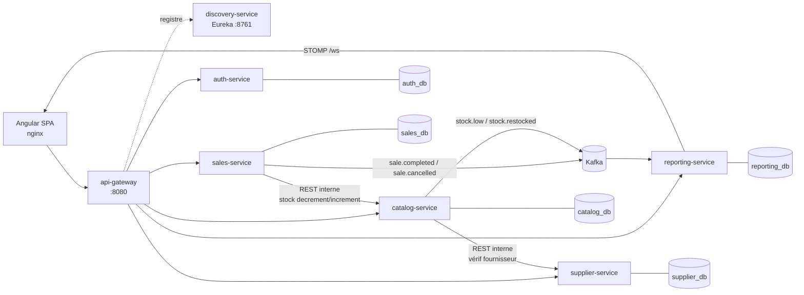

# IMPLEMENTATION — Store Management

Document technique compagnon de [PRD.md](PRD.md). Schéma détaillé des bases : [DATABASE_SCHEMA.md](DATABASE_SCHEMA.md).

## 1. Stack technique

| Couche | Techno | Version cible |
|---|---|---|
| Langage backend | Java | 21 (LTS) |
| Framework | Spring Boot | 3.5.x |
| Persistance | Spring Data JPA + Hibernate | (via Boot) |
| Migrations | Flyway (`ddl-auto=validate`) | (via Boot) |
| Sécurité | Spring Security + OAuth2 Resource Server (JWT HS256) | (via Boot) |
| Microservices | Spring Cloud Gateway (server-webflux), Eureka, OpenFeign | 2025.0.x |
| Messaging | Apache Kafka (KRaft, sans Zookeeper) + Spring for Apache Kafka | 3.9 |
| Temps réel | Spring WebSocket + STOMP | (via Boot) |
| Base de données | PostgreSQL | 16 |
| Frontend | Angular (standalone components, signals) | 20 |
| UI | Angular Material | 20 |
| Graphes | Chart.js (via un composant `app-chart` de 40 lignes, chargé seulement par le tableau de bord) | 4.x |
| WebSocket client | @stomp/rx-stomp | 2.x |
| Build | Maven (multi-module) / Angular CLI | — |
| Conteneurs | Docker + Docker Compose | — |
| Tests | JUnit 5, Testcontainers (Postgres, Kafka), Jasmine/Karma | — |

## 2. Architecture distribuée



### 2.1 Services

| Service | Port | Responsabilité (modules PRD) | Base |
|---|---|---|---|
| `discovery-service` | 8761 | Registre Eureka | — |
| `api-gateway` | 8080 | Point d'entrée unique, routage `/api/<service>/**`, CORS, proxy WebSocket | — |
| `auth-service` | 8081 | Stores, utilisateurs, rôles, permissions, émission du JWT (M1) | `auth_db` |
| `catalog-service` | 8082 | Catégories, produits, stock, remises, restockages (M2, M3, M5) | `catalog_db` |
| `supplier-service` | 8083 | Fournisseurs (M4) | `supplier_db` |
| `sales-service` | 8084 | Ventes, lignes, annulation, données du ticket (M6, M7) | `sales_db` |
| `reporting-service` | 8085 | Agrégats de ventes, CA, graphes, notifications temps réel (M8, M9, M10). Modèle de lecture en JPA (entités à clé composite) ; cumuls par `INSERT … ON CONFLICT` natif, atomique entre instances | `reporting_db` |

**Règle d'or** : chaque service possède ses tables ; aucun service ne lit la base d'un autre. Entre services, les références passent par ID, avec une copie (snapshot) des données affichées.

### 2.2 Communication

**Synchrone (REST via OpenFeign + Eureka)**, quand la réponse est nécessaire pour continuer :

| Appelant → Appelé | Endpoint interne | Pourquoi synchrone |
|---|---|---|
| sales → catalog | `POST /internal/stock/decrement` | Refuser la vente si le stock est insuffisant ; obtenir le prix remisé faisant foi et un `reservationId` |
| sales → catalog | `POST /internal/stock/reservations/{id}/release` | Compensation uniquement (vente non enregistrée, espèces insuffisantes) : rend exactement la sortie de stock de cette réservation, une seule fois, par son auteur, dans les 5 minutes |
| catalog → supplier | `GET /suppliers/{id}` (route publique, JWT de l'utilisateur transmis) | Valider le fournisseur du store et récupérer son nom (snapshot) ; pas de route interne dédiée, la publique suffit |

Les routes `/internal/**` ne sont **pas** exposées par la gateway, et chaque service les protège lui-même (cf. §3) : un intercepteur Feign (`FeignJwtForwarding`) propage le JWT de l'utilisateur **et** le secret de service `X-Internal-Token`.

**Asynchrone (Kafka)**, pour les effets de bord qui ne doivent pas bloquer la caisse :

| Topic | Producteur | Consommateur | Payload (clé = `storeId`) |
|---|---|---|---|
| `sale.completed` | sales | reporting | `saleId, storeId, cashierId, cashierName, saleDate (date locale), total, lines[{productId, productName, categoryId, categoryName, qty, unitPrice, discountPercent, lineTotal}]` |
| `sale.cancelled` | sales | catalog (recrédit du stock), reporting | même payload que `sale.completed` (pour soustraire) |
| `stock.low` | catalog | reporting | `storeId, productId, productName, stockQty, alertThreshold, type (LOW \| OUT)` |
| `stock.restocked` | catalog | reporting | `storeId, productId, stockQty, alertThreshold` |

- **Transactional outbox** (aucun événement perdu) : le service n'envoie jamais directement à Kafka. `OutboxPublisher.publish(topic, key, event)` insère l'événement dans la table `outbox_event` **dans la même transaction** que la donnée métier. `OutboxRelay` (planifié toutes les 500 ms) lit les lignes non envoyées (`FOR UPDATE SKIP LOCKED`, donc sans conflit si plusieurs instances tournent), les envoie à Kafka, puis pose `sent_at`. Les lignes envoyées sont purgées après 7 jours. Code : `backend/common/.../outbox/`, activé par `@Import(OutboxConfig.class)` dans catalog et sales.
- Livraison *at-least-once* : l'id de l'événement est envoyé dans le header Kafka `eventId`. Les consommateurs sont **idempotents** grâce à la table `processed_event(event_id)` (catalog, reporting), via `ProcessedEvents` du module `common`.

### 2.3 Flux critiques

**Encaissement**
1. Angular → `POST /api/sales/sales` `{lines:[{productId, qty}], cashReceived}`.
2. sales → catalog `POST /internal/stock/decrement` `{lines}`. Dans une seule transaction catalog, pour chaque ligne :
   `UPDATE product SET stock_qty = stock_qty - :qty WHERE id = :id AND store_id = :storeId AND stock_qty >= :qty AND deleted = false`.
   0 ligne modifiée → rollback, `409 INSUFFICIENT_STOCK {productId}`.
   catalog calcule la remise effective (max des remises actives produit + catégorie) et renvoie `{productId, name, categoryId, categoryName, unitPrice, discountPercent}`.
   Si le stock ≤ seuil après décrément → `stock.low`.
3. sales vérifie `cashReceived ≥ total`, enregistre `sale` + `sale_line` (snapshots), calcule la monnaie à rendre.
   Si l'enregistrement échoue → appel compensatoire `increment`.
4. sales écrit `sale.completed` dans l'outbox (même transaction que la vente) et renvoie la vente → Angular ouvre le ticket et lance `window.print()`.

> Le contrôle `cashReceived ≥ total` peut aussi se faire avant le décrément, en recalculant le total via un `GET /internal/prices` ; v1 : compensation simple.

**Annulation** : `POST /api/sales/sales/{id}/cancel` (`SALE_CANCEL`) → `UPDATE … status = CANCELLED WHERE status = COMPLETED` (atomique : une seule annulation réussit) + `sale.cancelled` dans l'outbox, même transaction → catalog consomme l'événement et recrédite le stock (idempotent). Aucun appel synchrone : une annulation ne peut ni recréditer deux fois, ni rester à moitié faite.

**Restockage** : `POST /api/catalog/restocks` `{productId, supplierId, qty, unitCost?}` (`STOCK_RESTOCK`) → catalog → supplier (vérification et nom, appel fait hors transaction) → `UPDATE … stock_qty = stock_qty + qty` + ligne `restock` + `stock.restocked` dans l'outbox (même transaction) → reporting résout la notification ouverte si le stock > seuil.

**Notification** : reporting consomme `stock.low` → insère la notification si aucune n'est ouverte pour `(store, product, type)` (index unique partiel) → push STOMP vers `/topic/stores/{storeId}/notifications`. Le statut lu/non lu est **propre à chaque utilisateur** (table `notification_read`) : `GET /notifications?unread=true` renvoie celles que l'utilisateur courant n'a pas encore lues.

## 3. Sécurité & multi-tenant

- `auth-service` émet un JWT (HS256, durée 8 h) avec les claims : `sub` (userId), `storeId`, `storeName`, `tz` (fuseau du store), `name`, `role`, `permissions[]`.
- **Chaque service** valide le JWT lui-même (`spring-boot-starter-oauth2-resource-server`, secret partagé via la variable d'env `JWT_SECRET`) : la sécurité ne repose pas sur la gateway seule.
- `permissions[]` est converti en `GrantedAuthority` : `@PreAuthorize("hasAuthority('PRODUCT_WRITE')")`.
- **Routes internes** : `InternalApiFilter` (module `common`) exige l'en-tête `X-Internal-Token` = `INTERNAL_SECRET` sur `/internal/**`, comparé en temps constant ; sans secret configuré, tout `/internal/**` est refusé. Un utilisateur qui joindrait directement un service avec son propre JWT (même avec la bonne permission) reçoit 403. Le JWT reste exigé en plus : le service appelé applique store et permissions du caissier.
- **storeId toujours lu du token**, jamais du body ni de l'URL. Toutes les requêtes des repositories filtrent par `storeId` (méthodes `findByIdAndStoreId`…).
- Les mots de passe sont hachés en BCrypt.
- WebSocket : le JWT est passé dans le header STOMP `CONNECT`, et un `ChannelInterceptor` refuse un `SUBSCRIBE` sur un `storeId` différent de celui du token.
- Changement de permissions : il devient effectif au prochain login (v1, pas de révocation de token).

## 4. Structure du dépôt

```
store_management/
├── PRD.md  IMPLEMENTATION.md  DATABASE_SCHEMA.md
├── docker-compose.yml
├── .env.example                     # JWT_SECRET, mots de passe DB
├── backend/
│   ├── pom.xml                      # parent : versions Boot / Cloud, modules
│   ├── common/                      # seul module partagé
│   │   └── src/main/java/com/store/common/
│   │       ├── events/              # Events : topics + records Kafka (SaleEvent, StockLowEvent…)
│   │       ├── outbox/              # OutboxPublisher, OutboxRelay, OutboxConfig
│   │       ├── security/            # JwtSecurityConfig, CurrentUser (storeId, userId, tz…)
│   │       └── web/                 # ApiError, ApiException, GlobalExceptionHandler
│   ├── Dockerfile                   # unique, ARG MODULE=<service>
│   ├── discovery-service/
│   ├── api-gateway/
│   ├── auth-service/
│   ├── catalog-service/
│   ├── supplier-service/
│   ├── sales-service/
│   └── reporting-service/
└── frontend/                        # Angular
```

### 4.1 Structure type d'un service métier
```
catalog-service/src/main/java/com/store/catalog/
├── CatalogApplication.java
├── controller/      ProductController, CategoryController, DiscountController, RestockController, InternalStockController
├── service/         ProductService, DiscountService, StockService, RestockService
├── repository/      ProductRepository, …            (Spring Data JPA)
├── entity/          Product, Category, Discount, Restock (@Entity)
├── dto/             records request / response
├── client/          SupplierClient (@FeignClient)
└── kafka/           StockEventPublisher
src/main/resources/
├── application.yml
└── db/migration/    V1__init.sql …                  (Flyway)
```
Pas d'interface pour un service à implémentation unique, ni de mapper généré : les DTO sont des `record` construits à la main.

## 5. API REST (exposée via la gateway)

Toutes les routes sont préfixées `/api/<service>`. Pagination Spring standard (`?page=&size=&sort=`).

**auth** — `/api/auth`
| Méthode | Route | Accès |
|---|---|---|
| POST | `/register` | public (crée store + ADMIN) |
| POST | `/login` | public → `{token}` |
| GET | `/me` | connecté |
| GET/POST | `/users` | `USER_MANAGE` |
| PUT | `/users/{id}` | `USER_MANAGE` (nom, actif) |
| PUT | `/users/{id}/role` | `USER_MANAGE` (GUEST ↔ MANAGER) |
| PUT | `/users/{id}/permissions` | `USER_MANAGE` (`{permissions:[…]}`) |
| GET | `/permissions` | `USER_MANAGE` (catalogue) |

**catalog** — `/api/catalog`
| Méthode | Route | Accès |
|---|---|---|
| GET | `/categories` | connecté |
| POST/PUT/DELETE | `/categories[/{id}]` | `CATEGORY_WRITE` |
| GET | `/products?categoryId=&q=&stock=ALL\|LOW\|OUT` | connecté (inclut le prix remisé courant) |
| POST/PUT/DELETE | `/products[/{id}]` | `PRODUCT_WRITE` |
| GET | `/discounts?status=ACTIVE\|UPCOMING\|PAST` | connecté |
| POST/PUT/DELETE | `/discounts[/{id}]` | `DISCOUNT_WRITE` |
| GET | `/restocks?productId=&supplierId=&from=&to=` | connecté |
| POST | `/restocks` | `STOCK_RESTOCK` |

**supplier** — `/api/suppliers`
| Méthode | Route | Accès |
|---|---|---|
| GET | `/` , `/{id}` | connecté |
| POST/PUT/DELETE | `/[{id}]` | `SUPPLIER_WRITE` |

**sales** — `/api/sales`
| Méthode | Route | Accès |
|---|---|---|
| POST | `/sales` | `SALE_CREATE` |
| GET | `/sales?date=&cashierId=` | les siennes ; tout le store avec `SALES_VIEW_ALL` |
| GET | `/sales/{id}` | idem (sert aussi au ticket) |
| POST | `/sales/{id}/cancel` | `SALE_CANCEL` |

**reporting** — `/api/reporting`
| Méthode | Route | Accès |
|---|---|---|
| GET | `/me/today` | connecté → `{cashedToday, ticketCount}` (ses ventes) |
| GET | `/today` | `SALES_VIEW_ALL` → produits vendus du jour, qté, encaissé, par caissier |
| GET | `/revenue?from=&to=` | `STATS_VIEW` → KPIs + série jour par jour |
| GET | `/top-products?from=&to=&categoryId=&limit=&by=QTY\|REVENUE` | `STATS_VIEW` |
| GET | `/top-categories?from=&to=&limit=&by=QTY\|REVENUE` | `STATS_VIEW` |
| GET | `/notifications?unread=true` | connecté |
| PUT | `/notifications/{id}/read` | connecté |
| WS | `/ws` → `/topic/stores/{storeId}/notifications` | connecté |

Format d'erreur commun : `{code, message, details}` (`VALIDATION_ERROR`, `INSUFFICIENT_STOCK`, `FORBIDDEN`, `NOT_FOUND`…).

## 6. Frontend Angular

```
frontend/src/app/
├── app.config.ts  app.routes.ts
├── core/
│   ├── auth/          auth.service.ts (session JWT en signal, `can(permission)`), auth.interceptor.ts, guards.ts, labels.ts
│   ├── ws/            notification-socket.service.ts (rx-stomp)
│   └── layout/        shell (sidenav + toolbar + cloche notifications)
├── features/
│   ├── auth/          login, register
│   ├── dashboard/     admin-dashboard (KPIs + 3 graphes + filtres), guest-dashboard (encaissé du jour)
│   ├── products/      liste, formulaire
│   ├── categories/
│   ├── stock/         produits restants / bas / rupture, restock-dialog, historique
│   ├── suppliers/
│   ├── discounts/
│   ├── pos/           caisse (panier, rendu monnaie), receipt (ticket 80mm)
│   ├── sales/         ventes du jour, détail, annulation
│   ├── users/         liste, rôle, cases à cocher permissions
│   └── notifications/
└── shared/            pipes (devise), composants communs
```

- Routes lazy (`loadComponent`) protégées par `authGuard` (+ un `permissionGuard` quand un écran en a besoin). Affichage conditionnel : `@if (auth.can('PRODUCT_WRITE'))`, sans directive dédiée. La route par défaut après login : dashboard admin si `STATS_VIEW`, sinon dashboard guest.
- Formulaires réactifs typés ; montants affichés via `CurrencyPipe`.
- **Ticket** : `receipt.component` est rendu dans la page ; une feuille `@media print { @page { size: 80mm auto; margin: 0 } }` masque tout le reste, puis `window.print()`.
- **Graphes** : Chart.js directement (`shared/chart.ts`), sans ng2-charts : chargé uniquement dans le chunk du tableau de bord. Une série par graphe (couleur unique validée, pas de légende), un seul axe, infobulle au survol et tableau « Voir les données » en alternative. Les filtres (période, catégorie, top N, quantité ou montant) relancent la requête de reporting concernée.
- La configuration de l'URL de l'API passe par `environment.ts` (`/api`, proxifié par nginx vers la gateway en prod, par `proxy.conf.json` en dev).

## 7. Déploiement (Docker Compose)

| Conteneur | Image | Notes |
|---|---|---|
| `postgres` | postgres:16 | Une instance, 5 bases créées par `init.sql` (un user par base) |
| `kafka` | apache/kafka:3.9.0 | Mode KRaft, topics auto-créés |
| `discovery` | build `backend/discovery-service` | |
| `gateway` | build `backend/api-gateway` | Seul backend exposé (8080) |
| `auth`, `catalog`, `supplier`, `sales`, `reporting` | build | `SPRING_DATASOURCE_*`, `JWT_SECRET`, `KAFKA_BOOTSTRAP` via `.env` |
| `frontend` | build `frontend` (node → nginx) | Expose 80, proxy `/api` et `/ws` vers la gateway |

> ponytail : une seule instance Postgres pour 5 bases logiques suffit en v1. Séparer en instances quand la charge l'exige ; le code n'a rien à changer.

Chaque service a un `Dockerfile` multi-stage (maven → eclipse-temurin:21-jre). `depends_on` + healthchecks (`/actuator/health`).

## 8. Conventions
- Montants : `BigDecimal` / `NUMERIC(12,2)`, arrondi `HALF_UP`.
- Dates : `Instant` / `TIMESTAMPTZ` en base ; la « journée » est calculée avec le fuseau du store (`tz` du JWT).
- Suppression logique via le champ `deleted` + filtre dans les requêtes (pas de `@SQLRestriction` magique).
- Concurrence du stock : `UPDATE … WHERE stock_qty >= :qty` atomique ; `@Version` sur `Product` pour les éditions concurrentes du formulaire.
- Routage : la gateway retire seulement `/api` (`StripPrefix=1`). Chaque service sert donc ses routes sous son propre préfixe (`/auth/**`, `/catalog/**`, `/suppliers/**`, `/sales/**`, `/reporting/**`). Les routes `/internal/**` restent inaccessibles depuis l'extérieur.
- CORS : inutile, car le front appelle `/api` sur la même origine (proxy Angular en dev, nginx en prod).

## 9. Tests (minimum attendu)
Tests d'intégration par service : `@SpringBootTest` + Testcontainers (vrai PostgreSQL) + MockMvc. Les JWT de test viennent de `TestTokens` (test-jar du module `common`).

- **catalog** : résolution de la remise (produit vs catégorie, la plus forte, bornes de dates) ; décrément concurrent sans survente (Testcontainers Postgres, 2 threads).
- **sales** : vente refusée en cas de stock insuffisant, calcul du rendu de monnaie, compensation.
- **reporting** : un événement consommé deux fois n'est compté qu'une fois ; une annulation retire bien des totaux.
- **auth** : isolation (un utilisateur du store A obtient 404 sur une ressource du store B).
- **frontend** : `permissionGuard` et `hasPermission`.

## 10. Plan de réalisation (lots)

| Lot | Contenu | Livrable vérifiable |
|---|---|---|
| 0 | Parent Maven, `common`, discovery, gateway, docker-compose (Postgres + Kafka) | `docker compose up` : Eureka voit la gateway |
| 1 | auth-service + Angular login/register/shell | Inscription → login → JWT → page vide protégée |
| 2 | catalog (catégories, produits) + supplier + écrans Angular | CRUD complet, isolation entre deux stores |
| 3 | Stock + restockage + remises | Restocker avec fournisseur ; prix remisé correct |
| 4 | sales + POS + ticket + annulation | Vente → stock décrémenté → ticket imprimé |
| 5 | reporting (Kafka) + dashboards + graphes | Encaissé du jour guest/admin ; graphes filtrables |
| 6 | Notifications WebSocket + gestion des users/permissions | Rupture → cloche en temps réel ; promotion d'un guest en MANAGER |
