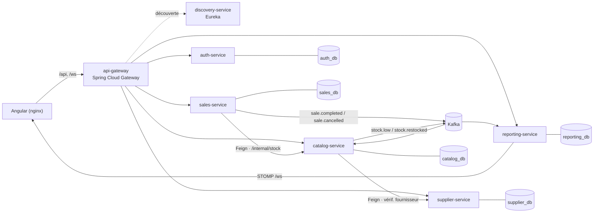

# Store Manager

Application web **SaaS de gestion de magasin**, construite en **microservices**. Chaque commerçant crée son magasin et en devient l'administrateur. Il gère ensuite son catalogue, son stock et ses fournisseurs, encaisse en caisse avec ticket imprimé et suit son chiffre d'affaires en temps réel.

- **Backend** : Java 21, Spring Boot 3.5, Spring Cloud (Gateway, Eureka, OpenFeign), Hibernate / JPA, PostgreSQL, Kafka.
- **Frontend** : Angular 20, Angular Material, Chart.js, STOMP sur WebSocket.
- **Exploitation** : Docker Compose, tests d'intégration avec Testcontainers.

---

## Sommaire

1. [Fonctionnalités](#fonctionnalités)
2. [Architecture](#architecture)
3. [Stack technique](#stack-technique)
4. [Structure du dépôt](#structure-du-dépôt)
5. [Démarrage rapide (Docker)](#démarrage-rapide-docker)
6. [Développement local](#développement-local)
7. [Tests](#tests)
8. [Sécurité](#sécurité)
9. [Documentation détaillée](#documentation-détaillée)
10. [Limites connues](#limites-connues)

---

## Fonctionnalités

### Rôles

| Rôle | Pour qui | Droits |
|---|---|---|
| **Administrateur** | Le commerçant qui a créé le magasin | Tout, y compris le chiffre d'affaires et la gestion des comptes |
| **Responsable** | Un caissier promu | Les droits que l'administrateur lui coche, un par un |
| **Caissier** | Un employé | Encaisser et voir son propre encaissé du jour |

Les droits sont des **permissions** : encaisser, annuler une vente, voir toutes les ventes, gérer les produits, les catégories, les fournisseurs et les remises, restocker, voir les statistiques, gérer les utilisateurs. Une nouvelle fonctionnalité sensible se protège en ajoutant une permission au catalogue.

### Par domaine

- **Catalogue**
  - Catégories et produits : prix, code-barres facultatif, seuil d'alerte.
  - Recherche, filtre « à restocker » ou « en rupture ».
  - Suppression logique : l'historique des ventes est conservé.
- **Stock et fournisseurs**
  - Restockage avec un fournisseur obligatoire, la quantité et un prix d'achat facultatif.
  - Historique filtrable par fournisseur et par période.
- **Remises**
  - Événements datés, sur un produit ou sur une catégorie.
  - Quand plusieurs remises s'appliquent, la plus forte l'emporte, sans cumul.
- **Caisse**
  - Panier, scan d'un code, paiement en espèces avec calcul de la monnaie à rendre.
  - **Ticket de caisse 80 mm** imprimé automatiquement.
  - Annulation d'une vente : le stock est recrédité.
- **Ventes du jour** : tickets, montant encaissé, articles vendus. Un caissier ne voit que ses propres ventes.
- **Tableau de bord administrateur**
  - Chiffre d'affaires sur une période, panier moyen, ruptures, courbe jour par jour.
  - Graphes des **produits** et des **catégories** les plus vendus, filtrables par période, catégorie, top N, quantité ou montant.
  - Encaissé du jour par caissier.
- **Notifications temps réel** : quand un produit passe sous son seuil ou tombe en rupture, une cloche s'allume. Chaque utilisateur a son propre statut lu, et un clic sur l'alerte ouvre directement le restockage.
- **Utilisateurs** : création de caissiers, promotion en responsable avec choix des droits, désactivation.

---

## Architecture



| Service | Rôle |
|---|---|
| `api-gateway` | Point d'entrée unique : il route `/api/**` et `/ws` et n'expose jamais `/internal/**` |
| `discovery-service` | Registre Eureka des instances |
| `auth-service` | Magasins, comptes, rôles et permissions, émission des JWT |
| `catalog-service` | Catégories, produits, stock, remises, restockages, réservations de stock |
| `supplier-service` | Fournisseurs |
| `sales-service` | Encaissement, tickets, annulations |
| `reporting-service` | Cumuls de ventes, chiffre d'affaires, graphes, alertes de stock et WebSocket |

### Principes

- **Une base PostgreSQL par service.** Un service ne lit jamais la base d'un autre : les références passent par identifiant, avec une copie des noms affichés.
- **Multi-magasin.** Le `storeId` vient toujours du JWT, jamais de la requête. Chaque requête filtre dessus.
- **Chaque service valide lui-même le JWT** (HS256). La gateway ne fait que router.
- **Aucun événement perdu (transactional outbox).** L'événement Kafka est écrit dans la même transaction que la donnée métier, puis un relais l'envoie. Le relais utilise `SKIP LOCKED`, ce qui permet de lancer plusieurs instances.
- **Consommateurs idempotents.** Un événement relivré n'est appliqué qu'une seule fois (table `processed_event`).
- **Stock sans survente.** Les sorties de stock sont atomiques et en tout ou rien. Un test vérifie qu'avec 10 ventes simultanées sur 5 articles, exactement 5 réussissent.
- **Annulation via Kafka.** Le catalogue recrédite le stock en consommant `sale.cancelled`. Une annulation ne peut ni être appliquée deux fois, ni rester à moitié faite.
- **Compensation liée à une réservation.** Si une vente échoue après la sortie de stock, le stock est rendu par une réservation, utilisable une seule fois, par son auteur, dans les 5 minutes.

---

## Stack technique

### Backend

| Technologie | Version | Usage |
|---|---|---|
| Java | 21 (LTS) | Langage, records, pattern matching |
| Spring Boot | 3.5.6 | Socle des 7 services |
| Spring Data JPA / Hibernate | 6.6 (via Boot) | **Toute** la persistance : entités, repositories, JPQL, verrous pessimistes |
| Flyway | via Boot | Migrations SQL versionnées ; Hibernate se limite à valider le schéma (`ddl-auto=validate`) |
| PostgreSQL | 16 | Une base par service |
| Spring Security + OAuth2 Resource Server | via Boot | Validation JWT et `@PreAuthorize` par permission |
| Spring Cloud Gateway (WebFlux) | 2025.0.0 | Routage, proxy WebSocket |
| Spring Cloud Netflix Eureka | 2025.0.0 | Découverte de services |
| Spring Cloud OpenFeign | 2025.0.0 | Appels REST entre services, avec transmission du JWT et du secret de service |
| Apache Kafka (KRaft) + Spring for Apache Kafka | 3.9 | Événements de vente et de stock |
| Spring WebSocket (STOMP) | via Boot | Notifications temps réel |
| Maven (wrapper) | 3.9.9 | Build multi-module |

### Frontend

| Technologie | Version | Usage |
|---|---|---|
| Angular | 20 | Composants standalone, signals, routes chargées à la demande |
| Angular Material | 20 | Composants d'interface (Material 3) |
| Chart.js | 4 | Graphes, chargés uniquement par le tableau de bord |
| @stomp/stompjs | 7 | Client WebSocket des notifications |
| nginx | 1.27 | Sert le front et relaie `/api` et `/ws` vers la gateway |

### Tests et exploitation

| Technologie | Usage |
|---|---|
| JUnit 5, MockMvc, AssertJ, Mockito | Tests d'intégration et unitaires |
| Testcontainers 1.21.4 | Vrais PostgreSQL et Kafka pendant les tests |
| Docker / Docker Compose | Lancement de toute la plateforme |

---

## Structure du dépôt

```
store_management/
├── PRD.md                    # fonctions métier, rôles, règles
├── IMPLEMENTATION.md         # architecture, flux, API, conventions
├── DATABASE_SCHEMA.md        # schéma de chaque base
├── docker-compose.yml        # plateforme complète
├── .env.example              # secrets à copier en .env
├── infra/postgres/           # création des 5 bases et utilisateurs
├── backend/                  # Maven multi-module
│   ├── common/               # contrat Kafka, outbox, idempotence, sécurité JWT, erreurs
│   ├── discovery-service/
│   ├── api-gateway/
│   ├── auth-service/
│   ├── catalog-service/
│   ├── supplier-service/
│   ├── sales-service/
│   ├── reporting-service/
│   └── Dockerfile            # image unique, ARG MODULE=<service>
└── frontend/                 # Angular
    └── src/app/
        ├── core/             # session JWT, intercepteur, guards, API, notifications, mise en page
        ├── features/         # dashboard, caisse, ventes, produits, stock, remises, fournisseurs, utilisateurs…
        └── shared/           # graphe, boîte de confirmation, dates
```

Chaque service suit la même organisation : `controller / service / repository / entity / dto`, avec ses migrations Flyway dans `src/main/resources/db/migration`.

---

## Démarrage rapide (Docker)

### Prérequis

- Docker Desktop (ou Docker Engine et Compose v2), avec environ 4 Go de mémoire disponible.

### Lancement

```bash
cp .env.example .env        # puis remplacer JWT_SECRET et INTERNAL_SECRET (32 caractères minimum chacun)
docker compose up -d --build
```

Ouvrez ensuite **http://localhost:4200**, cliquez sur **« Créer mon magasin »** : vous êtes administrateur. Ajoutez une catégorie, des produits et un fournisseur, puis encaissez depuis **Caisse**.

> Au premier démarrage, comptez environ 30 secondes pour que les services s'enregistrent auprès d'Eureka. D'ici là, la gateway peut répondre 503.

### Ports

| Service | Port hôte | Variable |
|---|---|---|
| Application (nginx) | 4200 | `FRONTEND_PORT` |
| API gateway | 8080 | `GATEWAY_PORT` (à changer si le port 8080 est déjà pris, par Apache ou XAMPP par exemple) |
| Eureka (tableau de bord) | 8761 | — |
| PostgreSQL | 5432 | — |
| Kafka (accès depuis l'hôte) | 9092 | — |

### Variables d'environnement (`.env`)

| Variable | Rôle |
|---|---|
| `POSTGRES_PASSWORD` | Mot de passe du super-utilisateur PostgreSQL |
| `DB_PASSWORD` | Mot de passe des utilisateurs `<service>_user` |
| `JWT_SECRET` | Clé HS256 partagée par tous les services, 32 caractères minimum |
| `INTERNAL_SECRET` | Secret service à service exigé sur `/internal/**`, 32 caractères minimum, différent de `JWT_SECRET` |

### Mettre à jour un seul service

```bash
docker compose up -d --build --no-deps catalog
```

`--no-deps` évite de recréer Eureka, dont le registre en mémoire serait vidé (les services se réenregistrent alors en 30 secondes environ).

---

### Mise en ligne

Neon, Render et Cloudflare Pages : voir **[DEPLOYMENT.md](DEPLOYMENT.md)**.

---

## Développement local

Démarrer l'infrastructure dans Docker et les services depuis l'IDE ou le terminal :

```bash
docker compose up -d postgres kafka discovery gateway

cd backend
./mvnw install -DskipTests
export JWT_SECRET=... INTERNAL_SECRET=... DB_PASSWORD=store
./mvnw -pl catalog-service spring-boot:run      # idem pour auth-, supplier-, sales-, reporting-service
```

Par défaut, les services se connectent à `localhost` : PostgreSQL sur 5432, Kafka sur 9092, Eureka sur 8761.

Pour le front, avec rechargement à chaud :

```bash
cd frontend
npm install
GATEWAY_PORT=8080 npm start     # http://localhost:4200, /api et /ws relayés vers la gateway
```

---

## Tests

```bash
cd backend
./mvnw verify          # Docker doit tourner : Testcontainers démarre PostgreSQL et Kafka
```

18 tests d'intégration sur de vrais conteneurs PostgreSQL et Kafka. Ils couvrent notamment :

- **Isolation entre magasins** : aucun magasin ne voit ni ne modifie les données d'un autre.
- **Permissions** : un caissier sans le droit requis est refusé.
- **Concurrence** : aucune survente, même avec des ventes simultanées.
- **Remises** : la plus forte s'applique, sans cumul.
- **Chaîne d'événements** : outbox, Kafka, idempotence, insensibilité à l'ordre d'arrivée.
- **Encaissement** : vente, compensation, annulation unique.
- **Reporting** : cumuls, chiffre d'affaires, classements.
- **Notifications** : envoi par WebSocket, statut lu par utilisateur, abonnements cloisonnés par magasin.
- **Routes internes** : refusées sans le secret de service, compensation à usage unique.

```bash
cd frontend && npx ng build      # build de production du front
```

---

## Sécurité

- **Mots de passe** hachés avec BCrypt. **JWT** HS256 valable 8 heures, qui porte le magasin, le rôle et les permissions.
- **Contrôle côté serveur** sur chaque route (`@PreAuthorize`). L'interface masque les actions interdites, mais seul le serveur fait foi.
- **Routes internes** (`/internal/**`) : jamais exposées par la gateway. Elles exigent en plus du JWT un **secret de service**, comparé en temps constant, et sont refusées si ce secret n'est pas configuré. Un utilisateur qui joindrait directement un service avec son propre token est donc rejeté.
- **WebSocket** : authentifié par le JWT dès la connexion. Un abonnement n'est accepté que sur le canal de son propre magasin, et seulement avec le droit « Restocker ».
- **Montants** en décimal exact (`NUMERIC` / `BigDecimal`), jamais en nombre à virgule flottante.

---

## Documentation détaillée

| Document | Contenu |
|---|---|
| [PRD.md](PRD.md) | Besoin, rôles et permissions, règles métier, critères d'acceptation |
| [IMPLEMENTATION.md](IMPLEMENTATION.md) | Architecture, flux (encaissement, annulation, restockage, notifications), API REST, conventions |
| [DATABASE_SCHEMA.md](DATABASE_SCHEMA.md) | Tables, contraintes et index de chaque base, requêtes clés |
| [DEPLOYMENT.md](DEPLOYMENT.md) | Mise en ligne : Neon (bases), Render (services, `render.yaml`), Cloudflare Pages (front et relais `/api`, `/ws`) |

---

## Limites connues

- **Paiement en espèces uniquement** (pas encore de terminal bancaire).
- **Changement de droits** : il prend effet à la prochaine connexion de l'utilisateur, car le JWT n'est pas révoqué.
- **Notifications temps réel** : le broker STOMP est en mémoire, ce qui limite le reporting à une seule instance. Pour en faire tourner plusieurs, il faudra passer par un broker externe (RabbitMQ).
- **Compensation d'une vente** : si elle échoue elle-même, l'incident est journalisé et la correction du stock est manuelle.
